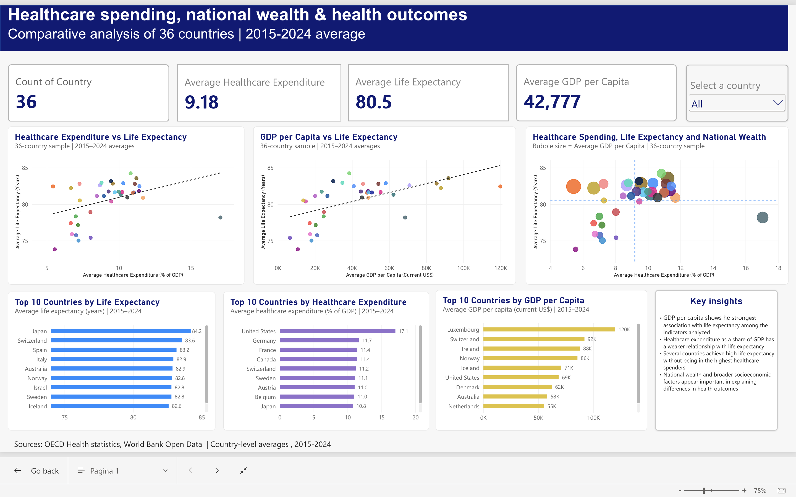

# Healthcare-analytics-dashboard
Power BI dashboard analyzing healthcare expenditure, GDP per capita and life expectancy across 36 countries
# Healthcare Analytics Dashboard



## Project Overview

This project analyzes the relationship between healthcare expenditure, national wealth, and life expectancy across 36 countries using data from the OECD and the World Bank.

The goal was to build an interactive Power BI dashboard that allows users to compare countries and identify patterns in healthcare spending, GDP per capita, and health outcomes.

## Data Sources

- OECD Health Statistics
- World Bank Open Data

The analysis uses country-level averages for the period 2015–2024.

## Tools Used

- **Excel** for data preparation and validation
- **Power Query** for cleaning and transforming the datasets
- **Power BI** for dashboard development and interactive visualization

## Data Preparation

The original datasets contained information on:

- Healthcare expenditure as a percentage of GDP
- Life expectancy
- GDP per capita in current US dollars

The datasets were cleaned, reshaped, and integrated into a consistent analytical structure. Country-level averages were then calculated for the 2015–2024 period.

The final workbook includes:

- `Raw_Data`
- `Country_Analysis`
- `PowerBI_Data`

## Dashboard Features

The Power BI dashboard includes:

- KPI cards for:
  - Number of countries
  - Average life expectancy
  - Average healthcare expenditure
  - Average GDP per capita
- Interactive country slicer
- Healthcare expenditure vs life expectancy scatter plot
- GDP per capita vs life expectancy scatter plot
- Bubble chart combining healthcare expenditure, life expectancy, and GDP per capita
- Top 10 countries by life expectancy
- Top 10 countries by healthcare expenditure
- Top 10 countries by GDP per capita
- Key insights panel

## Key Findings

- GDP per capita shows the strongest association with life expectancy among the indicators analyzed.
- Healthcare expenditure as a share of GDP shows a weaker relationship with life expectancy.
- Several countries achieve high life expectancy without being among the highest healthcare spenders.
- Broader socioeconomic and institutional factors appear important in explaining differences in health outcomes.

## Executive Summary

This project analyzes healthcare expenditure, GDP per capita, and life expectancy across 36 countries using OECD and World Bank data for the period 2015–2024.

The analysis suggests that **national wealth is more strongly associated with life expectancy than healthcare expenditure as a share of GDP**, but neither variable alone provides a sufficient explanation for differences in health outcomes across countries.

## Key Findings

### 1. National wealth matters, but explains only part of health outcomes

GDP per capita shows the strongest relationship with life expectancy among the indicators analyzed, with an R² of approximately **0.347**.

Wealthier countries therefore tend to have higher life expectancy, but substantial variation remains unexplained. This suggests that economic resources create favorable conditions for better health outcomes without guaranteeing them.

### 2. Higher healthcare spending does not automatically lead to better outcomes

Healthcare expenditure as a percentage of GDP shows a considerably weaker relationship with life expectancy, with an R² of approximately **0.155**.

This indicates that the share of national income devoted to healthcare is not, by itself, a strong predictor of population health.

The effectiveness with which healthcare resources are allocated and delivered may therefore matter as much as the amount spent.

### 3. The United States is a major outlier

The United States records the highest healthcare expenditure in the sample, at approximately **17.05% of GDP**, while average life expectancy is only about **78.18 years**, below the sample average.

This makes the United States a particularly important case of high expenditure combined with comparatively weak health outcomes.

The result highlights the limits of using spending levels alone as a measure of healthcare system performance.

### 4. Some countries achieve strong outcomes with more moderate resources

Japan records the highest life expectancy in the sample at approximately **84.23 years**, without being either the richest country or the largest healthcare spender.

Italy and Spain show a similar pattern. Italy achieves life expectancy of approximately **82.93 years** despite being below the sample average in both GDP per capita and healthcare expenditure.

These cases suggest that factors beyond financial resources—such as prevention, lifestyle, healthcare organization, accessibility, and institutional characteristics—may contribute materially to health outcomes.

### 5. Several countries combine below-average spending with above-average outcomes

The analysis identifies a group of countries with healthcare expenditure below the sample average but life expectancy above the average:

**Greece, Iceland, Ireland, Israel, Italy, Luxembourg, and Slovenia.**

However, this group is economically heterogeneous. Some countries, such as Luxembourg and Ireland, are relatively wealthy, while Greece, Italy, and Slovenia achieve high health outcomes with more moderate income levels.

This makes the latter countries particularly interesting from a healthcare management perspective.

### 6. Richer countries do not necessarily allocate a larger share of GDP to healthcare

The relationship between GDP per capita and healthcare expenditure as a percentage of GDP is weak, with an R² of approximately **0.073**.

Higher national income therefore does not automatically imply a higher healthcare spending share.

This also underlines an important methodological distinction: expenditure expressed as a percentage of GDP is different from healthcare expenditure per capita. A wealthy country may devote a smaller percentage of GDP to healthcare while still spending considerably more money per person.

## Strategic Implications

The analysis suggests that evaluating healthcare systems exclusively on the basis of spending can be misleading.

A more meaningful assessment should consider not only how many financial resources are available, but also:

- how efficiently those resources are allocated;
- access to healthcare services;
- prevention and primary care;
- demographic characteristics;
- lifestyle and behavioral factors;
- socioeconomic inequality;
- institutional quality.

For policymakers and healthcare managers, the key implication is that **increasing expenditure alone may not be sufficient to improve population health**. Understanding how resources are converted into outcomes is likely to be more informative than focusing exclusively on spending levels.

## Overall Conclusion

The results indicate that life expectancy is associated with economic resources, but the relationship is neither simple nor deterministic.

GDP per capita is a stronger predictor of life expectancy than healthcare expenditure as a share of GDP, yet several countries substantially outperform or underperform what their financial resources alone would suggest.

The contrast between countries such as Japan, Italy, and Spain and the United States illustrates the central insight of the analysis:

Healthcare performance depends not only on how much a country spends, but also on how effectively economic and healthcare resources are translated into population health outcomes.

The analysis remains descriptive and does not establish causality. Future research incorporating variables such as education, inequality, obesity, smoking, demographic structure, healthcare access, and institutional quality could help explain the remaining cross-country differences.

## Markdown 
[Read the full analysis discussion](docs/03_Analysis_discussion.md)

## Methodological Note

Healthcare expenditure is measured as a percentage of GDP, while GDP per capita is measured in current US dollars.

The analysis is descriptive and focuses on cross-country associations. The observed relationships should not be interpreted as causal effects.


## Repository Structure

 ## Repository Structure

```text
Healthcare-analytics-dashboard/
│
├── README.md
├── .gitattributes
│
├── data/
│   └── Healthcare_analytics_data.xlsx
│
├── docs/
│   └── 03_Analysis_discussion.md
│
└── images/
    └── dashboard_preview.png
```

### Folder Contents

- `data/` – cleaned and structured analytical dataset used for the Power BI dashboard
- `docs/` – extended analysis and discussion of the main findings
- `images/` – dashboard preview and visual assets
- `README.md` – project overview, methodology, key findings, and repository documentation

## Skills Demonstrated

- Data cleaning and transformation
- Multi-source data integration
- Exploratory data analysis
- Cross-country benchmarking
- Power BI dashboard design
- Interactive data visualization
- Analytical interpretation
